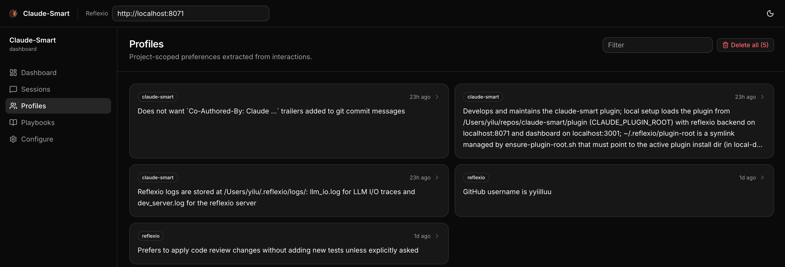
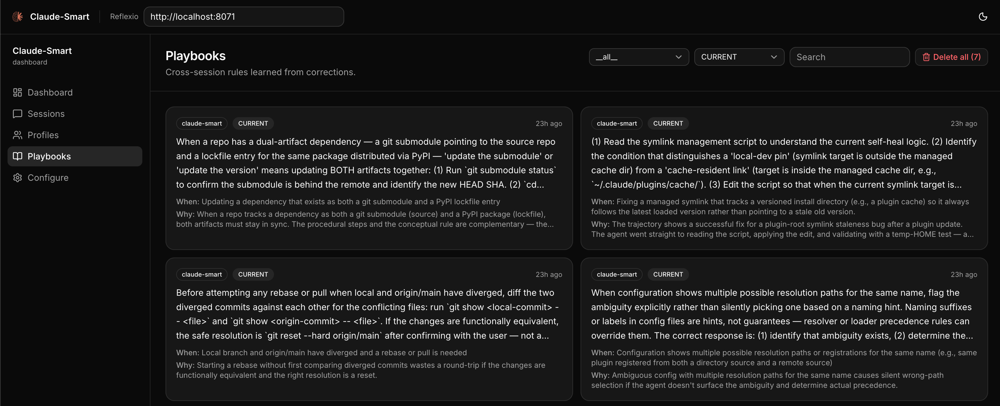

<p align="center">
  
</p>

<h1 align="center">
  claude-smart
</h1>

<h4 align="center">A self-improvement plugin for <a href="https://claude.com/claude-code" target="_blank">Claude Code</a>, Codex, and OpenCode that turns interactions into durable skills they follow in future sessions.</h4>

<p align="center">
  <a href="LICENSE">
    
  </a>
  <a href="plugin/pyproject.toml">
    
  </a>
  <a href="plugin/pyproject.toml">
    
  </a>
  <a href="package.json">
    
  </a>
  <a href="#quick-start">
    
  </a>
  <a href="https://discord.gg/7fnCxahase">
    
  </a>
  <a href="https://github.com/ReflexioAI/reflexio">
    
  </a>
</p>

<p align="center">
  <a href="#quick-start">Quick Start</a> •
  <a href="#how-it-works">How It Works</a> •
  <a href="#commands">Commands</a> •
  <a href="#dashboard">Dashboard</a> •
  <a href="#configuration">Configuration</a> •
  <a href="TROUBLESHOOTING.md">Troubleshooting</a> •
  <a href="#license">License</a>
</p>

<p align="center">
  claude-smart learns from your corrections <i>and</i> from what's already working — so the assistant stops repeating mistakes and reuses proven paths. Project-specific skills capture repo-local rules, and shared skills roll up durable patterns for reuse across projects.
</p>

<p align="center">
  <b>vs <code>claude-mem</code>:</b> ~3× better at turning your corrections into rules Claude follows, ~50% more of your guidance is retained. <a href="EXPERIMENT.md"><b>Read the benchmark →</b></a>
</p>

<p align="center">
  ⭐ Built on the open-source <a href="https://github.com/ReflexioAI/reflexio"><b>reflexio</b></a> engine — if claude-smart helps you, <a href="https://github.com/ReflexioAI/reflexio"><b>star reflexio on GitHub</b></a>.
</p>

---

## Quick Start

Requires Node.js 20+ (for `npx`) and the host CLI you're installing into (`claude`, `codex`, or `opencode`) on `PATH`.

### Guided installation

```bash
npx claude-smart install
```

Choose one or more detected coding agents with the arrow keys and Space, then
press Enter. Single-choice settings use the arrow keys and Enter. Esc or Ctrl+C
cancels before configuration is saved.

The guide asks where to store and process your data:

- **Local Reflexio:** starts a background backend on this machine. Choose which
  available agent CLI powers background learning; it can analyze interactions
  from every installed integration.
- **Managed Reflexio:** enter an HTTPS endpoint and a hidden API key. No local
  backend starts; memory storage and background learning run in Reflexio cloud.
  The local dashboard connects to that cloud backend by default.

In local mode, Claude Code learning defaults to the `sonnet` alias, which Claude
Code resolves independently of the coding model. Codex and OpenCode keep their
provider-configured defaults. An explicit supported model ID overrides these
choices. For unattended installs, use
`--model <model-id>` with `--provider`. The chosen model is applied to extraction
and optimizer calls. Managed mode reports the server-configured model when
available, otherwise explicitly reports that its default model is not exposed.
After install, update, or setup, the summary includes the Claude-smart version,
learning provider, provider CLI version when available, and model selection.
Configured aliases/defaults are distinguished from a reported model version;
unknown versions are shown as “not reported.” Run `npx claude-smart setup` to
change the learning settings.

The dashboard's **Data source** dropdown selects Local or Managed Reflexio.
It defaults to the saved runtime mode. Its endpoint, overview totals, preferences,
skills, and backend sessions follow the selected source; viewing another source
does not change learning/storage settings. The header shows the selected endpoint
as a read-only connection label, with an **Open cloud dashboard** link in Managed
mode. Change connection settings in **Configure**. Overview metrics use backend summary
counts for the last 30 days, rather than list limits. Connection failures are
shown explicitly. Older skill citations without a project/shared identity remain
visible under Legacy skill usage; exact per-skill counts use identified citations.
A backend must be configured and reachable to view its data.
The dashboard follows the managed Reflexio workspace style: neutral light/dark
surfaces, green accents, flat metric bands, and consistent page spacing. The
theme switch applies across dashboard, sessions, preferences, skills, and settings.
Previously configured connections are retained privately when changing modes.
The dashboard currently trusts local OS users: other accounts on a shared machine
can access its configured backend connections. Per-user dashboard authentication
requires a separate change.

**This device** lists local session buffers and hook activity separately. Those
counts can differ between machines connected to the same managed account.

Review the configuration before installation starts. Saved settings and installed
agents are preselected on subsequent runs. Preparation and service startup show
phase and elapsed progress; detailed logs live in `~/.claude-smart/install-logs/`.
If an integration fails, the others still install and the summary reports each result.
Runtime environments remain separate so an agent's rollback cannot break another.

### Explicit installation

For an unattended first install, specify the backend. Multiple agents can be
installed in one command:

```bash
npx claude-smart install --host claude-code,codex --backend local --provider codex
npx claude-smart install --host opencode --backend local --provider opencode --global
```

For managed mode, supply the API key through a named environment variable rather
than a command-line argument:

```bash
npx claude-smart install --host claude-code,codex --backend managed \
  --url https://www.reflexio.ai/ --api-key-env REFLEXIO_API_KEY
```

Existing `--host codex` and `--host opencode` commands still work. Without a terminal,
saved backend/provider settings are reused; a fresh install requires `--backend`.
Use `--yes` to skip interactive questions when all required settings are supplied
or saved. For multiple local agents, specify `--provider` unless one is already saved.
Use `--read-only` to retrieve memories without publishing interactions, or `--learn`
to resume learning. The interactive guide offers both modes for either backend.

### Activate each integration

Run `/reload-plugins` in your existing Claude Code session, or use the update in your next session.
Start a new Codex session to load the update; you can finish your existing session first. If hook trust needs review, use `/hooks`.
Then restart OpenCode in your project so it loads the plugin from `opencode.json`. Add `--global` to install for all OpenCode projects on this machine instead.

### Check an update

```bash
npx claude-smart status
npx claude-smart status --host codex
```

Shows the installed version and the version each recent session last used in a hook. Historical observations do not confirm that a session is still active. Codex uses `CODEX_HOME` when set; run installation and status with the same account home as your session.

### Uninstall

```bash
npx claude-smart uninstall                    # Choose integrations interactively
npx claude-smart uninstall --host claude-code,codex  # Remove multiple integrations
npx claude-smart uninstall --host claude-code  # Claude Code
npx claude-smart uninstall --host codex       # Codex
npx claude-smart uninstall --host opencode    # OpenCode
```

Afterward, use `/reload-plugins` in Claude Code, start a new Codex session, or restart OpenCode. Learned data under `~/.reflexio/` and `~/.claude-smart/` is preserved and shared across hosts, so you can uninstall or switch hosts without losing skills or preferences.

Uninstall keeps saved configuration and the chosen background learning provider.
Removing an integration does not uninstall its agent CLI. Remaining integrations
can continue using the same learning provider. OpenCode removal applies to the
current project config, or its global config with `--global`.

For per-host details — what the installers and uninstallers touch, OpenCode config resolution and model/env overrides, and Windows notes — see [Host install notes](./DEVELOPER.md#host-install-notes) in DEVELOPER.md. Developing the plugin itself? See [Developing locally](./DEVELOPER.md#developing-locally).

> **Not supported:** Claude Code Cowork, claude.ai/code web, or remote Codex environments without local plugin hooks — they run outside your local machine, so the local backend/dashboard and `~/.reflexio/` aren't reachable.

---

## Why Learning, Not Memory

Most memory tools just record. Claude remembers what happened, but doesn't change what it does next.

`claude-smart` focuses on learning instead.

Four things this changes:

- 💡 **Stop repeating the same mistakes:** Produces actionable skills Claude can follow next time; memory only records what happened.

  > *Example:* a deploy fails after Claude bumps `prisma` from 5.x to 6.0; you tell it to roll back because 6.0 breaks nested writes in your order flow.<br>
  > **Memory:** “deploy broke after prisma bump; user rolled back”<br>
  > **Learning:** “treat major-version bumps of ORMs/DB drivers as breaking — verify with integration tests, not just unit tests”

- 🚀 **Start from the optimized path:** Records and optimizes the steps that worked so Claude can reuse them, instead of re-exploring each session.
  > *Example:* Claude spends several iterations trying to start the local dev environment before discovering that this repo requires `pnpm dev:all` instead of the usual `npm run dev`.<br>
  > **Memory:** “user mentioned that `npm run dev` did not work”<br>
  > **Learning:** “for this repo, always use `pnpm dev:all` to start the full local stack — `npm run dev` only starts the frontend and causes missing service errors”

  Instead of re-exploring, Claude Code starts from the proven path—reducing planning steps, latency, and token usage.

- 🌐 **Project-specific and shared skills:** Session memory disappears with the conversation. Project-specific skills preserve repo-local rules, while shared skills roll up patterns that should transfer across projects. Preferences stay scoped to the current project so per-repo preferences don't leak across projects.

- 🪶 **Better context without prompt bloat:** Distilled, deduplicated skills stay in dozens of tokens—not thousands—even as the project grows.

---

## Demo

https://github.com/user-attachments/assets/ed84d73a-d5b7-4a0d-ab2c-f2c060c3f276

---

## Key Features

- 🧠 **Learn, don't just remember** — Corrections become structured, deduplicated rules, not transcript replays.
- ⚡ **Fully automatic learning** — Every user turn, tool call, and assistant response is captured via lifecycle hooks and extracted into rules without you running anything.
- 📈 **Continuously self-tuning, not just append-on-conflict** — Existing rules are continuously refined, not just appended to. Wording gets clearer, *when-to-apply* triggers tighten or broaden as evidence accumulates, near-duplicates merge, stale rules are superseded, and dead ones are archived. The library gets sharper, not just bigger.
  > *e.g.* correct the same `npm test --run` gotcha twice → consolidated into one rule. New evidence shows it applies to `vitest` too → scope broadened. Switch policy to `pnpm test` → old rule archived, new one supersedes it.
- 🔌 **Local or managed storage** — in local mode, semantic search runs on an in-process ONNX embedder (all-MiniLM-L6-v2) and memories stay on this machine. Managed mode stores and processes memories on the configured cloud backend; device interaction buffers remain local.
- 🔎 **Hybrid search** — Skills and preferences are indexed with vector + BM25 search for fast, robust retrieval.
- 🧪 **Offline resilience** — If the reflexio backend is down, hooks buffer to disk; the next successful publish drains them.
- 🧰 **Manual correction marker** — `/claude-smart:learn` in Claude Code, or `bash ~/.reflexio/plugin-root/scripts/cli.sh learn` in Codex, flags the last turn as a correction so the extractor weights it heavily.

---

## Dashboard

A web UI for browsing session histories, inspecting preferences, and editing project-specific and shared skills. The local backend binds to `127.0.0.1:8071` by default. The dashboard auto-starts in both local and managed mode at **http://localhost:3001**. Its data-source selector defaults to your saved runtime mode; managed mode reads cloud totals without starting a local backend. Or run `/claude-smart:dashboard` in Claude Code to open it in your browser. In Codex, run `bash ~/.reflexio/plugin-root/scripts/dashboard-open.sh`.

<p align="center">
  
  
</p>

---

## How It Works

claude-smart builds three artifacts as you work and injects the relevant ones into Claude Code, Codex, or OpenCode:

- **Preferences** (project-scoped) — how you work in this specific repo (stack, role, small quirks). *e.g.* "uses pnpm, not npm"; "prefers terse answers"; "backend engineer — explain frontend with backend analogues."
- **Project-specific skills** — durable rules with triggers and rationales learned from corrections in a project. *e.g.* "always pass `--run` to `npm test` — watch mode hangs CI."
- **Shared skills** — optimized rollups of project-specific skills that should transfer across projects. *e.g.* "use real Postgres for integration tests — mocks once hid a broken migration."

Skills clean themselves up: correct the same thing twice and they merge; change your mind and the old one is archived.

Under the hood: hooks watch your turns, tool calls, and assistant replies, auto-flagging corrections (or anything you flag with `/claude-smart:learn`). At session end (or on `/claude-smart:learn`), [reflexio](https://github.com/ReflexioAI/reflexio) — the self-improving engine that powers claude-smart — extracts preferences and project-specific skills, then rolls durable patterns into shared skills. On each new user prompt, claude-smart searches for matching context and injects only the relevant hits. Run `/claude-smart:show` or the equivalent CLI command to audit the current learned state. Everything runs on your machine.

**Citations.** At the end of a reply, the assistant may append a short marker:

```
✨ claude-smart rule applied: [git safety](http://localhost:3001/rules/s1-123) | [brief answer preference](http://localhost:3001/rules/p1-pref) · [⚡Reflexio](https://github.com/ReflexioAI/reflexio)
```

That signals a preference or skill materially shaped the reply.
Open the session's detail page in the [dashboard](http://localhost:3001) to see the exact cited item.

See [ARCHITECTURE.md](./ARCHITECTURE.md) for hooks, data flow, and reflexio details.

---

## Commands

Claude Code installs these as plugin slash commands. Codex does not currently
support plugin-provided slash commands, so claude-smart ships a Codex skill that
maps requests like "claude-smart show" or "run claude-smart learn" to the
equivalent action.

| Claude Code | Codex request | What it does |
| --- | --- | --- |
| `/claude-smart:dashboard` | `open claude-smart dashboard` | Open the dashboard in your browser, auto-starting the reflexio backend and dashboard services if they aren't already running. |
| `/claude-smart:show` | `claude-smart show` | Print current project-specific skills, shared skills, and the current project's preferences so you can audit learned state manually. |
| `/claude-smart:learn [note]` | `claude-smart learn with note "optional note"` | Flag the most recent turn as a correction (for cases the automatic heuristic missed) and force reflexio to run extraction *now* on the session's unpublished interactions. The optional note becomes the correction description the extractor sees. |
| `/claude-smart:restart` | `restart claude-smart` | Restart the reflexio backend and dashboard to pick up new changes (e.g. after upgrading the plugin or editing local reflexio code). |
| `/claude-smart:clear-all` | `clear all claude-smart learnings` | **Destructive.** Delete *all* reflexio interactions, preferences, and skills. Use when you want to wipe learned state and start fresh. |

---

## Configuration

Advanced users can tune claude-smart via environment variables — see [DEVELOPER.md](./DEVELOPER.md#environment-variables) for the full list.

### Where data lives

| Path | What |
| --- | --- |
| `~/.reflexio/data/reflexio.db` | Source of truth for learned preferences, skills, interactions, full-text indexes, and embedding tables (plus `.db-shm` / `.db-wal` WAL sidecars). Inspect with `sqlite3`. |
| `~/.claude-smart/.env` | claude-smart config read by the hooks, backend, installer, and `npx claude-smart setup` — `CLAUDE_SMART_HOST`, `CLAUDE_SMART_USE_LOCAL_CLI`, `CLAUDE_SMART_OPENCODE_PATH`, and in managed mode `REFLEXIO_URL` / `REFLEXIO_API_KEY`. |
| `~/.claude-smart/claude-code/claude-smart/` | Claude Code's stable local copy of the active npm package, registered as the `reflexioai` marketplace. Claude Code runs the plugin in place from its `plugin/` dir. |
| `.claude/settings.local.json` or `~/.claude/settings.json` | Claude Code hook environment, such as `CLAUDE_SMART_ENABLE_OPTIMIZER`; use project-local settings for one repo or user settings for all projects. |
| `~/.codex/config.toml` | Codex plugin state, hook feature flags, and per-hook trust entries after `claude-smart install --host codex`. |
| `~/.codex/plugins/cache/reflexioai/claude-smart/<version>/` | Codex's cached install of the `claude-smart` plugin from the `ReflexioAI` marketplace. |
| `opencode.json` / `opencode.jsonc`, or existing `.opencode/opencode.json*` | OpenCode local plugin config patched by `claude-smart install --host opencode`; the installer updates only the claude-smart entry in OpenCode's plugin list. |
| `~/.claude-smart/opencode/claude-smart/` | OpenCode's stable local copy of the active npm package. OpenCode config points here with `file://` so restarts do not re-resolve `claude-smart` from npm. |
| `~/.reflexio/plugin-root` | Self-healed symlink to the active plugin dir (managed by `ensure-plugin-root.sh` — written on install, refreshed each `SessionStart`). Claude Code slash commands and Codex shell-command helpers resolve through it, so don't delete it; if you do, the next session will recreate it. |
| `~/.claude-smart/sessions/{session_id}.jsonl` | Per-session buffer. User turns, assistant turns, tool invocations, `{"published_up_to": N}` watermarks. Safe to inspect and safe to delete — everything past the latest watermark has already been written to reflexio's DB. |
| `~/.claude-smart/node/current/` | Private Node.js/npm runtime used by hooks and the dashboard after install. |
| `~/.cache/chroma/onnx_models/all-MiniLM-L6-v2/` | Cached ONNX weights (~86 MB, downloaded once). Delete to force a re-download. |

Upgrading from `CLAUDE_SMART_USE_LOCAL_EMBEDDING` requires removing the retired
assignment after preserving the effective model, endpoint and timeout policy.
See the [embedding upgrade guide](https://github.com/ReflexioAI/claude-smart/blob/main/DEVELOPER.md#upgrade-from-the-old-embedding-flag), including the case where an old local default shadowed a written `off`.

For troubleshooting, see [TROUBLESHOOTING.md](./TROUBLESHOOTING.md).

---

## Powered by Reflexio

claude-smart is powered by [**Reflexio**](https://github.com/ReflexioAI/reflexio) ([reflexio.ai](https://reflexio.ai)) — the open-source self-improving engine that turns interactions into durable, reusable skills. If claude-smart is useful to you, **[⭐ star reflexio on GitHub](https://github.com/ReflexioAI/reflexio)**.

---

## License

This project is licensed under the **Apache License 2.0**. Reflexio is a separate Apache 2.0 project consumed as the `reflexio-ai` Python package. Claude Code is Anthropic's and not covered by this license.

See the [LICENSE](LICENSE) file for details.

---

## Support

- **Discord**: join the community at [discord.gg/7fnCxahase](https://discord.gg/7fnCxahase).
- **Issues**: open one on GitHub describing the symptom and include the reflexio backend log (`~/.claude-smart/backend.log`) and the relevant lines of `~/.claude-smart/sessions/{session_id}.jsonl`.

---

**Powered by** [Reflexio](https://github.com/ReflexioAI/reflexio) · **Runs on** [Claude Code](https://claude.com/claude-code), Codex, and OpenCode · **Written in** Python 3.12+

Search hooks reserve a durable request identity in the session buffer before
retrieval. The corresponding response is published with that same identity;
retries keep it, and searches after a frozen publish belong to a later response.
Older buffered publishes keep their existing retry IDs. Cancelled turns do not
attach their retrieved-playbook references to a later prompt's answer. Search
alone does not supply a conversation or an outcome for offline tuning: the
response still needs to be published. Buffer writes and identity reservations
share a cross-process file lock on Linux, macOS, and native Windows.


### Short sessions and completion

Automatic session completion keeps Reflexio's usefulness judge enabled. Claude
Code's SessionEnd publishes an unsaved tail, then sends a completion hint even if
Stop already saved every message. Acceptance does not mean extraction has finished.
Explicit `/learn` remains a manual force operation.

With the updated Reflexio backend, publish-only integrations (including Codex,
OpenCode, and direct clients) evaluate short sessions after six hours without a new
publication in the same session. The operator can configure
`extraction_idle_timeout_seconds` (`21600` by default, `0` disables for new
publications). This fallback is a low-urgency policy, not proof a session ended.
Normal full-window and stride extraction still runs promptly. A negative judge
result produces no learning and is recorded as examined.

Extraction cadence is owned by the Reflexio server: configure `window_size` and
`stride_size` there. Starting a client session preserves those settings. The
former hook overrides `CLAUDE_SMART_WINDOW_SIZE` and `CLAUDE_SMART_STRIDE_SIZE`
are no longer read; remove them from launchers and set the server configuration
explicitly when a benchmark needs a different cadence. Existing persisted values
are preserved; fresh servers use their own defaults.

Managed mode requires a server update; changing the plugin alone cannot update a
cloud server. An older server retains saved messages and logs that completion is
unsupported; the plugin does not republish or force extraction. Idle fallback
starts with new publications after backend upgrade; old saved sessions can be
explicitly finalized on the updated backend.

### Publish-time playbook evidence

User-playbook search receipts travel with the injected learning references in the
on-disk buffer and are sent unchanged on publish. Distinct receipts for one
playbook are retained, so a later revision cannot overwrite an earlier injection.
Reflexio stores exposure evidence with the interaction rather than writing it on
search. ID-only references remain supported but have unverified served versions.
Update the SDK/server together to receive this metadata; older search response
models may omit receipts. The server stores only a receipt digest in the
interaction, and client recovery uses it to compare the original submission.
Normal installs require `reflexio-ai>=0.2.32`; `plugin/uv.lock` resolves the
published SDK from PyPI. Keep the SDK/server upgrade coordinated: older SDK
response models can omit receipts, and older servers retain their existing
exposure behavior. ID-only publication remains compatible.
